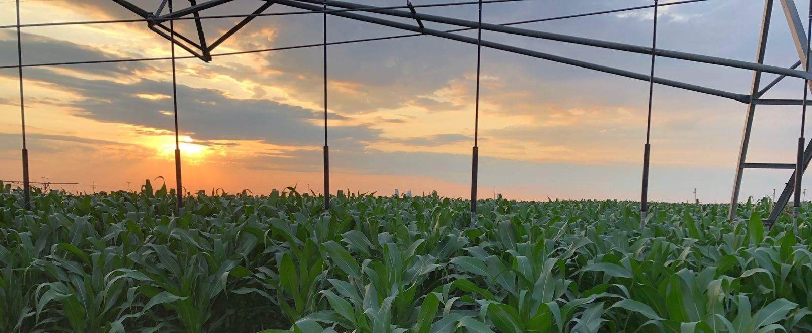
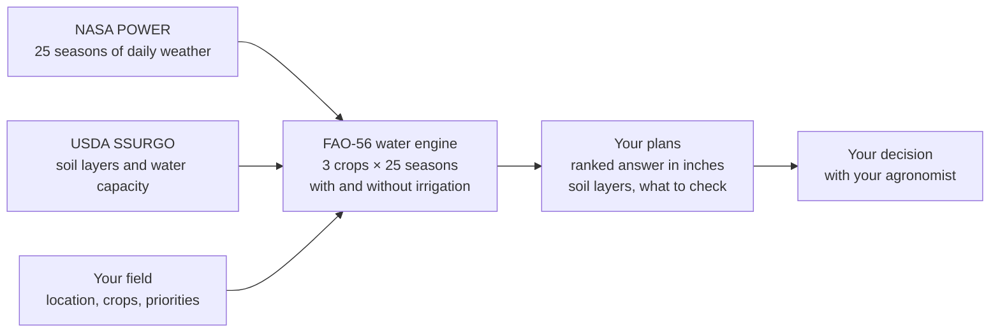
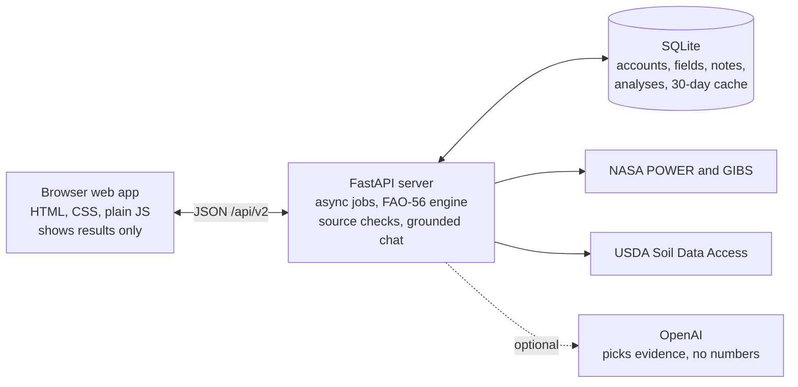

# AstroRoot

**Pick the crop that fits the water your field really gets.**
AstroRoot replays 25 past seasons of NASA weather on a field's mapped USDA soil through the FAO-56 crop-water equations, and compares corn, soybean and sorghum in plain words: inches of irrigation, seasons short of water, and what to check next.

Built for the **NASA Space Apps Challenge 2026** challenge *Field Shift: Adapting Farms with NASA Data*.


<sub>Photo: R.C. Schwartz, USDA Agricultural Research Service (public domain)</sub>

> **Research preview.** Results are a historical comparison, not a forecast, an irrigation prescription, or a yield or profit prediction. Field-level accuracy is not yet validated.

---

## Contents

- [The problem](#the-problem)
- [The solution](#the-solution)
- [Features](#features)
- [How it works](#how-it-works)
- [Data sources](#data-sources)
- [Science and methods](#science-and-methods)
- [Architecture](#architecture)
- [Project structure](#project-structure)
- [Getting started](#getting-started)
- [Testing](#testing)
- [Deployment](#deployment)
- [Validation status and limits](#validation-status-and-limits)
- [Space Apps judging alignment](#space-apps-judging-alignment)
- [Documentation](#documentation)
- [Credits](#credits)

## The problem

Farmers choose next season's crop with little evidence about how that crop would cope with the water their own field receives. A wrong choice costs irrigation water, pumping money and yield in a dry year.

- **The data exists but is scattered.** Decades of daily weather (NASA) and detailed soil maps (USDA) are public, but they sit in scientific services farmers do not use.
- **The physics is specialist work.** Turning weather and soil into crop water use needs the FAO-56 equations, run day by day, season by season.
- **One season is not enough.** A single wet or dry year misleads; a fair comparison needs many past seasons on the same field.
- **Advice tools rarely show their evidence.** Farmers are asked to trust a number without seeing where it came from.

## The solution



The farmer brings the field and what they know; public records supply the weather and soil; the engine does the physics; the plans hand the farmer evidence to decide with, not an instruction.

## Features

| Area | What it does |
|---|---|
| **Short answer** | Crops ranked by irrigation need (or rain-fed shortfall) in inches, with how many seasons ran short of water |
| **Plan cards** | Current crop and two options side by side: crop sequence, water needs, roots and soil, rotation note |
| **Soil layers** | A to-scale cross-section: rain and crop water use, root zone, water the soil can hold, recent NASA soil moisture |
| **Add-a-field wizard** | 4 short steps (location, crops and water, soil, priorities); phone location, map tap or coordinates; "I don't know" always allowed |
| **Map** | MapLibre map of the 50 states with NASA GIBS rain and soil-moisture layers and national model grids |
| **Year by year** | Every past season plotted; excluded seasons stay visible as gaps |
| **Ask AstroRoot** | A grounded chat that explains results from evidence cards; it cannot invent numbers |
| **Agronomist inbox** | Send a field and its comparison to an agronomist; replies appear in the account |
| **Field notes** | Private dated notes with photos; shared only when the farmer chooses |
| **Reports** | Print-ready PDF and Markdown reports with sources, equations and assumptions |
| **Accounts** | Private fields, data export, account deletion, one-time recovery code |
| **Phone first** | Installable web app, works offline for the app shell, 17 px text for outdoor reading |

## How it works

1. **Mark the field** on the map, with the phone's location, or by coordinates.
2. **Match the point to a state** (point-in-polygon on U.S. Census boundaries); points outside the 50 states are refused.
3. **Check coverage** of NASA weather and USDA soil at that point.
4. **Answer four short steps** about crops, water, soil and priorities.
5. **Start the comparison**: the server returns a job at once and works in the background.
6. **Match the weather**: NASA POWER daily values for the grid cell containing the point, in local solar time; location, dates and units are verified.
7. **Match the soil**: the USDA soil map unit under the point; the dominant major component's layers give water-holding capacity and its hydrologic group sets runoff.
8. **Match crops to seasons**: the catalog's planting date fixes each season; seasons not fully covered by weather are excluded, never filled in.
9. **Replay the physics** day by day for each crop and season.
10. **Summarise** 25 seasons as a median with a 10th–90th percentile range.
11. **Show the plans** and let the farmer ask, share or export.

## Data sources

| Source | Provides | Used in the calculation |
|---|---|---|
| [NASA POWER](https://power.larc.nasa.gov/) Daily API, community AG | Rain, temperature, dew point, humidity, wind, solar radiation, pressure | Yes |
| [USDA SSURGO](https://websoilsurvey.nrcs.usda.gov/) via Soil Data Access | Soil layers, available water capacity, hydrologic group, restrictive layers | Yes |
| U.S. Census Bureau 2023 state boundaries | Outlines of the 50 states | Location only |
| [NASA GIBS](https://www.earthdata.nasa.gov/engage/open-data-services-software/earthdata-developer-portal/gibs-api) | IMERG rain-rate and SMAP soil-moisture map tiles | No (imagery only) |
| NASA MERRA-2 via POWER | Surface and root-zone soil wetness, labelled MERRA-2 | No (context) |
| NASA SMAP via POWER | Soil moisture (POWER currently returns no values) | No (context) |

Every record, live, cached for 30 days or saved for the offline demo, passes the same checks: matching location, dates and units; physically impossible values rejected; NASA's fill value treated as missing.

## Science and methods

The engine follows FAO Irrigation and Drainage Paper 56 (FAO-56):

- **Reference evapotranspiration (ET₀)**: FAO Penman–Monteith (Eqs. 6–47).
- **Crop coefficient (Kc)**: growth-stage curve (Eq. 66), adjusted for each season's wind and humidity (Eqs. 62, 63, 65).
- **Crop demand**: ETc = Kc × ET₀.
- **Runoff**: USDA SCS curve number (TR-55 row crops: A 67, B 78, C 85, D 89).
- **Daily root-zone water balance** (Eqs. 80–88), with total and readily available water (TAW, RAW; Eqs. 82–83).
- **Two scenarios per season**: rain-fed (shortfall, stress days) and irrigated (net irrigation need).
- **Closure check**: each season's water balance must close; the residual is stored.

Equations, units and references are listed on the app's methods page (`/science/`) and in [docs/equation-register.md](docs/equation-register.md).

## Architecture



- **No science runs in the browser.** Every number comes from the server with its source and unit.
- **Background jobs**: a comparison returns `202` with a job; the browser checks it every 0.9 s; up to 16 jobs run at once.
- **No frontend build**: the server serves the web app and the API from one origin.

## Project structure

```text
.
├── backend/                FastAPI app (Python 3.12)
│   ├── app/
│   │   ├── adapters/       NASA POWER, USDA SSURGO, CDL, supplemental products: fetch + strict validation
│   │   ├── api/            /api/v2 routes: analyses, data, products, map, chat, accounts, validation
│   │   ├── science/        FAO-56, crop coefficients, water balance, statistics
│   │   ├── services/       analysis engine, sources and caching, reports, chat, accounts, map layers
│   │   ├── geo/            50-state boundary checks
│   │   ├── domain/         crop catalog
│   │   ├── validation/     pilot and hold-out evaluation
│   │   └── db/             SQLite schema
│   ├── tests/              pytest suite (140 tests)
│   └── tools/              grid builds, diagnostics, source checks
├── frontend/               Web app: landing (/), workspace (/workspace/), methods (/science/), expert inbox (/expert/)
│   ├── app.js              workspace app
│   ├── soil-profile.js     soil-layers view
│   ├── map-layers.js       NASA and model map layers
│   ├── theme.css           AstroRoot theme (liquid glass)
│   └── assets/photos/      public-domain USDA photos
├── data/
│   ├── catalogs/           crops, state boundaries, NASA GIBS layers
│   ├── fixtures/           saved real records for offline demo sites
│   └── validation/         station data and protocol for validation
├── docs/                   method, data sources, decisions, validation, deployment, archive of earlier specs
├── compose.yaml            Docker Compose
├── render.yaml, vercel.json  free demo deployment
└── Start-FieldShift.ps1    local launcher (Windows)
```

## Getting started

Requires **Python 3.12**. No Node.js or frontend build is needed to run the app.

```bash
python -m venv backend/.venv
# Windows
backend/.venv/Scripts/python -m pip install -r backend/requirements.txt
cd backend && .venv/Scripts/python -m uvicorn app.main:app --host 127.0.0.1 --port 8000
# macOS / Linux
backend/.venv/bin/python -m pip install -r backend/requirements.txt
cd backend && .venv/bin/python -m uvicorn app.main:app --host 127.0.0.1 --port 8000
```

Open <http://127.0.0.1:8000/>. The saved Hays, Kansas example (`/workspace/?demo=ks_hays`) works without internet. API docs are at `/docs`. On Windows you can also run `./Start-FieldShift.ps1` from the repository root.

### Configuration

Optional private settings go in `backend/.env` (ignored by Git; see `backend/.env.example`):

| Variable | Purpose |
|---|---|
| `OPENAI_API_KEY`, `OPENAI_MODEL` | Enable AI evidence selection in the chat (needs API credits) |
| `FIELD_SHIFT_AI_DAILY_CALL_LIMIT` | Daily cap on AI requests (default 50) |
| `CIMIS_APP_KEY` | California CIMIS reference data for validation tools |
| `FIELD_SHIFT_EXPERT_KEY` | Random key that enables the agronomist inbox at `/expert/` |
| `FIELD_SHIFT_DB` | SQLite file path (default `field_shift.db`) |
| `FIELD_SHIFT_LAYER_DIR` | Folder for national map layers |

Never commit real keys. Keys stay on the server and are never sent to the browser.

### Command line

```bash
cd backend
python -m app.cli --site ks_hays --irrigation rain-fed
python -m app.cli --live --lat 41.59 --lon -93.62 --out result.json --report report.md
```

### National map layers

```bash
cd backend
python tools/build_scientific_grid.py --year 2020 --all-crops --concurrency 3
```

Builds one season for all three crops on a 3,557-point grid across the 50 states. Outputs are runtime artifacts (in `outputs/scientific-layers/` or `FIELD_SHIFT_LAYER_DIR`), not part of the repository.

## Testing

```bash
cd backend && python -m pytest -q        # 140 tests
node --test frontend/tests/*.test.mjs    # frontend logic (Node 18+)
```

Tests cover FAO-56 worked examples, water-balance closure, rejection of corrupted sources, ownership isolation, account recovery, data export and asynchronous UI behaviour. Passing tests verify the implementation; they do not establish field accuracy.

## Deployment

- **Docker Compose:** `docker compose up --build -d` serves the app and API on `127.0.0.1:8000`, with SQLite, caches and layers in a named volume, a non-root user and a health check at `/api/v2/health`. Put an HTTPS reverse proxy in front for public use.
- **Free demo (Vercel + Render):** see [docs/deploy-free.md](docs/deploy-free.md). Render's free tier has no persistent storage, so saved accounts and fields disappear on restart.

Run one API process until jobs and SQLite are replaced by an external queue and shared database. More in [docs/full-app-delivery.md](docs/full-app-delivery.md).

## Validation status and limits

| Check | Status |
|---|---|
| FAO-56 worked examples, water-balance closure | Pass |
| Backend test suite | 140 tests pass |
| Source integrity on every record | Enforced |
| Frozen weather screening against independent stations | Not qualified: 4 of 21 station-seasons passed all provisional gates |
| Field irrigation accuracy | Not established |
| Agronomist review of crop parameters | Outstanding |

Known limits: weather is a grid cell tens of kilometres wide, not the field; soil is a mapped estimate, not a test; only three crops and the 50 U.S. states; numeric SMAP is unavailable from POWER (MERRA-2 is shown instead, labelled); AI answers need OpenAI credits. Details: [docs/project-evidence.md](docs/project-evidence.md).

## Space Apps judging alignment

| Criterion | What to show | Honest limit |
|---|---|---|
| Impact | A farmer saves a field, compares three crops, keeps notes, asks an agronomist, exports a report | Outcomes and water savings not yet measured in a pilot |
| Creativity | NASA weather, mapped USDA soil, the farmer's context and FAO-56 physics in one ranked answer and a to-scale soil cross-section | The shortfall score compares options; it is not a probability |
| Validity | Equations traceable on the methods page; tests, closure checks, source hashes, frozen screening | Field accuracy and agronomic review outstanding |
| Relevance | NASA POWER weather is part of the core calculation; GIBS, SMAP and MERRA-2 add context | One 2020 national scenario map |
| Presentation | Saved Hays example, plain-language plans in inches, photos, phone-first layout | No usability study yet |

Demo path: the farmer's question, then their field and context, then NASA and USDA evidence, then three comparable plans, then what to check with a local expert.

## Documentation

| Document | Contents |
|---|---|
| [docs/data-sources.md](docs/data-sources.md) | Each source, its units, periods and checks |
| [docs/equation-register.md](docs/equation-register.md) | Every equation with its reference |
| [docs/decision-log.md](docs/decision-log.md) | Design and scope decisions |
| [docs/project-evidence.md](docs/project-evidence.md) | What the evidence supports and what it does not prove |
| [docs/validation/](docs/validation/) | Validation protocol, reports and results |
| [docs/backend-handoff.md](docs/backend-handoff.md), [docs/scientific-delivery.md](docs/scientific-delivery.md) | API contracts and delivery notes |
| [docs/archive/](docs/archive/) | Earlier product specifications (Field Shift v3–v4) |

## Credits

- Weather and soil-moisture data: **NASA** POWER, GIBS, SMAP and MERRA-2. Soil data: **USDA NRCS** SSURGO. State boundaries: **U.S. Census Bureau**.
- Photos: **USDA Agricultural Research Service** image gallery (public domain), by R.C. Schwartz, Tom Trout, Stephen Ausmus, Scott Bauer, Keith Weller and Peggy Greb. Use of these data and photos does not imply endorsement by NASA or USDA.
- Method: FAO Irrigation and Drainage Paper 56 (Allen et al., 1998).
- Basemap: OpenFreeMap and OpenStreetMap contributors; map rendering by MapLibre GL JS.

AstroRoot is an independent project created for the NASA Space Apps Challenge 2026.
